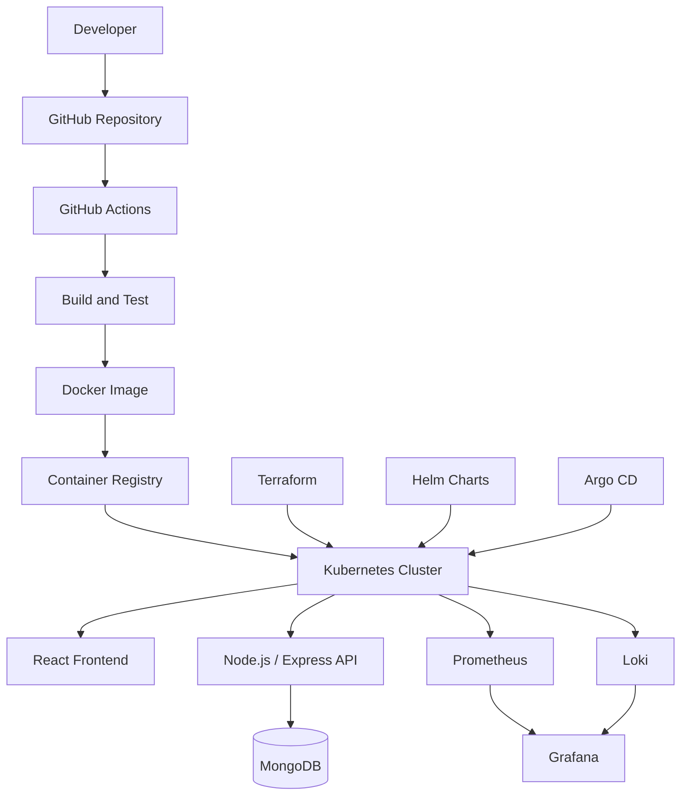

# HelloWorld DevOps 🚀

### End-to-End DevOps Automation for a MERN Stack Application

[](https://www.mongodb.com/mern-stack)
[](https://www.docker.com/)
[](https://kubernetes.io/)
[](https://github.com/features/actions)
[](https://developer.hashicorp.com/terraform)

**HelloWorld DevOps** is a hands-on project focused on implementing modern DevOps practices for a full-stack MERN application. It brings application development and infrastructure automation together through containerization, continuous integration and delivery, Kubernetes orchestration, GitOps, and observability.

The project explores how a web application can move from source code to a repeatable deployment workflow, with an emphasis on automation, reliability, scalability, security, and operational visibility.

**Repository:** [mulikshivam02/HelloWorld-DevOps](https://github.com/mulikshivam02/HelloWorld-DevOps)

---

## 🎯 Project Goals

- **Automated CI/CD:** Build, test, and validate application changes automatically.
- **Containerization:** Package application components into reproducible Docker images.
- **Container orchestration:** Deploy and manage workloads using Kubernetes.
- **Infrastructure as Code:** Define supported infrastructure and deployment resources using Terraform.
- **GitOps:** Explore declarative deployment management with Argo CD.
- **Observability:** Monitor metrics and visualize application and infrastructure health.
- **Centralized logging:** Collect and investigate logs using Loki.
- **DevSecOps:** Integrate vulnerability scanning and secure configuration practices.

## 🏗️ Architecture

The intended end-to-end workflow connects application development, automated validation, container delivery, deployment, and monitoring.



*This diagram represents the target workflow. Components should be marked as implemented only after their configuration and integration have been verified.*

## 🧰 Technology Stack

| Category | Technologies | Responsibility |
|---|---|---|
| Frontend | React.js | User interface |
| Backend | Node.js, Express.js | API and application logic |
| Database | MongoDB | Persistent data storage |
| Containers | Docker, Docker Compose | Packaging and local orchestration |
| CI/CD | GitHub Actions | Automated validation and build workflows |
| Orchestration | Kubernetes, kubectl | Application deployment and management |
| Packaging | Helm | Reusable Kubernetes configurations |
| IaC | Terraform | Declarative infrastructure management |
| GitOps | Argo CD | Git-driven deployment synchronization |
| Monitoring | Prometheus, Grafana | Metrics and dashboards |
| Logging | Loki | Log collection and querying |
| Security | Trivy | Vulnerability scanning |

## 🔄 DevOps Lifecycle

### 1. Source Control

Application code and deployment configuration are maintained in Git, enabling version tracking, collaboration, and reviewable changes.

### 2. Continuous Integration

GitHub Actions can automate dependency installation, testing, code checks, and application builds when changes are pushed or submitted through pull requests.

### 3. Containerization

Docker images package application components and their runtime dependencies, helping maintain consistent environments across development and deployment.

### 4. Deployment and Orchestration

Kubernetes manages application workloads, service discovery, restart behavior, and deployment updates. Helm can simplify the management of Kubernetes resources.

### 5. Infrastructure Automation

Terraform can define and manage supported infrastructure resources through version-controlled configuration and reviewable execution plans.

### 6. GitOps

Argo CD can compare the desired Kubernetes state stored in Git with the live cluster state and synchronize approved changes.

### 7. Monitoring and Logging

Prometheus collects configured metrics, Grafana visualizes operational data, and Loki supports centralized log analysis.

### 8. Security

Automated scanning, secret protection, access controls, and reviewable deployment changes help reduce common security risks.

## 🖥️ Local Development

### Prerequisites

- Git
- Node.js and npm
- MongoDB or an accessible MongoDB instance
- Docker Desktop

Install Kubernetes, Kind, kubectl, Helm, Terraform, and Argo CD when working on the corresponding DevOps stages.

### Clone the repository

```bash
git clone https://github.com/mulikshivam02/HelloWorld-DevOps.git
cd HelloWorld-DevOps
```

### Install application dependencies

Inspect the repository structure and install dependencies in the appropriate frontend and backend directories.

```bash
cd frontend
npm install
```

In a separate terminal:

```bash
cd backend
npm install
```

Adjust directory names to match the actual repository layout.

### Configure the environment

Create local environment files using the project's existing examples. Configure the MongoDB connection string, backend port, frontend API URL, and any other required variables.

Never commit real credentials or production secrets.

### Run the application

Start the backend using its configured npm script, then start the frontend using its development script.

```bash
npm run dev
```

Run the command from the appropriate application directory. The available scripts can be checked in `package.json`.

## 🐳 Containerization

Once Dockerfiles and the necessary configuration are available, build the application images:

```bash
docker build -t helloworld-backend ./backend
docker build -t helloworld-frontend ./frontend
```

If the repository contains a Compose configuration:

```bash
docker compose up --build -d
docker compose ps
docker compose logs -f
```

Stop the local services with:

```bash
docker compose down
```

## ☸️ Kubernetes

The Kubernetes deployment workflow can cover:

- Deployments and Services
- ConfigMaps and Secrets
- Readiness and liveness probes
- Resource requests and limits
- Rolling updates and rollback
- Persistent storage where required
- Ingress and traffic routing
- Horizontal scaling when metrics and resource requirements are configured

Useful diagnostic commands:

```bash
kubectl get nodes
kubectl get pods -A
kubectl get deployments -A
kubectl get services -A
kubectl get events -A
```

## 📊 Observability

The monitoring stack can provide operational visibility into application and infrastructure behavior.

| Component | Purpose |
|---|---|
| Prometheus | Collects metrics from configured targets |
| Grafana | Visualizes metrics and dashboards |
| Alertmanager | Routes configured alerts |
| Loki | Stores and queries logs from configured sources |

Monitoring coverage depends on the exporters, scrape targets, dashboards, log collectors, and alert rules configured in the environment.

## 🔐 Security Practices

- Keep credentials out of source control.
- Use least-privilege access for automation and cluster operations.
- Scan container images and dependencies for known vulnerabilities.
- Validate configuration before deployment.
- Review infrastructure plans before applying changes.
- Require appropriate approval for production modifications.
- Avoid exposing internal services or administrative dashboards publicly without suitable access controls.

## 🗺️ Implementation Roadmap

- [ ] Validate the existing MERN application.
- [ ] Containerize application components.
- [ ] Add automated CI workflows.
- [ ] Build and publish container images.
- [ ] Deploy the application to Kubernetes.
- [ ] Manage deployment resources using Helm.
- [ ] Automate supported infrastructure with Terraform.
- [ ] Configure GitOps using Argo CD.
- [ ] Integrate Prometheus and Grafana.
- [ ] Add centralized logging with Loki.
- [ ] Add vulnerability scanning and deployment safeguards.
- [ ] Document deployment verification and recovery procedures.

## 👨‍💻 Author

**Shivam Mulik**

GitHub: [@mulikshivam02](https://github.com/mulikshivam02)

Project: [HelloWorld DevOps](https://github.com/mulikshivam02/HelloWorld-DevOps)

---

**Built to explore the complete journey from application code to automated deployment and observability.**
